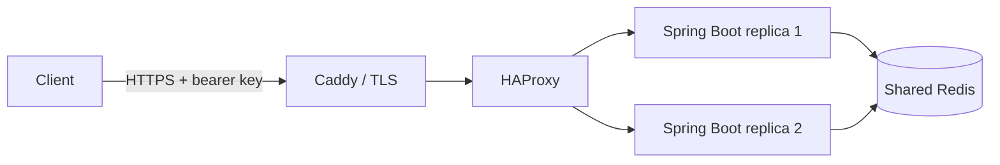

# Distributed Rate Limiter

## Summary / Deliverable

A Java 21 / Spring Boot REST API for per-tenant, per-resource quotas. It supports fixed-window and token-bucket rules, stores shared state in Redis, and uses atomic Lua scripts so concurrent requests across app replicas cannot overspend quota.

- Public endpoint: `https://68-183-94-203.sslip.io`
- Public API routes require `Authorization: Bearer <API_KEY>`.
- Source and CI: [subahshaam/do-rate-limiter](https://github.com/subahshaam/do-rate-limiter)

## HLD



Caddy terminates HTTPS. HAProxy distributes requests to both application containers. Both replicas use the same Redis instance for rules and quota state. See [docs/architecture.md](docs/architecture.md) for request and rule-update flows.

## LLD

### API

| Method | Path | Purpose |
|---|---|---|
| `POST` | `/v1/evaluate` | Consume quota and return allow/deny, remaining capacity, and reset time |
| `GET` | `/v1/quota/{tenantId}/{resource}` | Inspect quota state without consuming quota |
| `GET` | `/v1/rules` | List configured rules |
| `GET` | `/v1/rules/{tenantId}/{resource}` | Read one rule |
| `POST` | `/v1/rules` | Create a rule |
| `PUT` | `/v1/rules/{tenantId}/{resource}` | Update a rule |
| `DELETE` | `/v1/rules/{tenantId}/{resource}` | Delete a rule and its quota state |

Evaluation request:

```json
{"tenantId":"tenant-a","resource":"search"}
```

Evaluation response:

```json
{"allowed":true,"remaining":9,"resetAt":1795241224075}
```

`resetAt` is Unix epoch time in milliseconds. Rules contain `algorithm`, `sustainedLimit`, `burstCapacity`, and `windowSeconds`. Without an explicit rule, the default is token bucket: 10 requests per 60 seconds with burst capacity 20.

### Algorithms and Redis state

- **Fixed window:** Redis stores a request counter and reset timestamp. It is simple, but may allow bursts on adjacent window boundaries. `burstCapacity` is unused for this algorithm.
- **Token bucket:** Redis stores token balance and last-refill time. Tokens replenish at `sustainedLimit / windowSeconds`, up to `burstCapacity`.
- Rule values are stored under `rate-limit:rule:*`; quota state is stored under `rate-limit:state:*`.
- A Lua script performs each evaluation’s read/check/update atomically in Redis. Redis serializes script execution, bounding contention to that single operation.

## Monitoring

Spring Boot Actuator exposes:

- `/actuator/health` — overall health, including Redis.
- `/actuator/health/readiness` — readiness; includes Redis health.
- `/actuator/health/liveness` — process liveness.

Health routes are public for probes. Missing or invalid API keys receive HTTP `401`. If Redis is unavailable, the service fails closed with HTTP `503` and `REDIS_UNAVAILABLE`. No metrics or tracing backend is configured in this demo.

## Maintainability

- `src/main/java/com/example/demo/RateLimitController.java` — HTTP API.
- `RateLimitService.java` — Redis rule/state access and Lua evaluations.
- `ApiKeyFilter.java` — bearer-key enforcement in the `public` profile.
- `QuotaSnapshotCalculator.java` — quota snapshot calculations.
- `src/test/java/com/example/demo/` — unit and HTTP/Redis integration tests.
- `docker-compose.deploy.yml`, `Dockerfile`, and `Caddyfile` — deployment stack.
- `.github/workflows/ci.yml` — CI test and package pipeline.

The API key is supplied via `RATE_LIMIT_API_KEY` and must be kept in an untracked `.env` file on the server. Never commit it or put it in a URL. The current deployment runs all containers on one Droplet; Redis replication/failover and multi-host availability are not configured. Rule reads are not cached.

## Test

Run tests with Java 21, Maven, and a Redis instance available at the configured `REDIS_HOST`/`REDIS_PORT`:

```bash
REDIS_HOST=localhost mvn verify
```

`mvn verify` runs algorithm boundary/refill unit tests, HTTP controller tests, Redis-backed CRUD and concurrency tests, Redis-unavailable behavior tests, and public-profile API-key tests. GitHub Actions starts Redis, runs the same verification, and packages the application on pushes and pull requests.

## Deployment

The DigitalOcean deployment uses one Droplet with Caddy, HAProxy, two Spring Boot containers, and Redis. The public URL is `https://68-183-94-203.sslip.io`; `/v1/**` requires a bearer key. HAProxy and Redis are not directly exposed publicly.

The app key is mandatory in the server’s untracked `/opt/rate-limiter/.env`. Caddy obtains and renews the HTTPS certificate. The Droplet is a single-host failure domain and is billable while active. Do not remove bearer authentication or expose the internal app/Redis ports.
