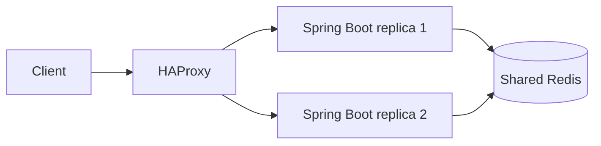

# Architecture

## Request lifecycle

## Evaluation path

1. `POST /v1/evaluate` supplies a tenant and resource namespace.
2. The application loads that tenant/resource rule from Redis (or uses the documented default token-bucket rule).
3. It builds a state key scoped to the tenant and resource.
4. The selected Redis Lua script atomically reads and updates the shared quota state. Redis serializes each script execution, so concurrent evaluations across replicas cannot both consume the same final token/counter slot.
5. The response includes `allowed`, `remaining`, and an epoch-millisecond `resetAt`.

`GET /v1/quota/{tenantId}/{resource}` reads the same state and computes the current snapshot without consuming capacity.

## Rule updates

Rule create/update writes the serialized rule to Redis and adds its key to the rule index. Delete removes the rule and its quota state. Both replicas read the same Redis rule store, so updates apply without a process restart.

## State and failure behavior

Redis is the shared source of truth for rules and counters. The service fails closed: if Redis is unavailable, rule/evaluation requests return `503 REDIS_UNAVAILABLE`; they do not grant quota using local state. Readiness includes the Redis health indicator, while liveness reports process health.

## Known limitations

- This deployment has two application containers on one Droplet. It demonstrates shared-state correctness, but the Droplet and Redis are single-host failure domains.
- Redis persistence is enabled with AOF in Compose, but this demo does not configure Redis replication, managed failover, backup/restore procedures, or an eviction policy.
- The API has no authentication or authorization. The deployed proxy binds to loopback and should not be exposed publicly until TLS, authentication, and access controls are added.
- Fixed windows can allow bursts on either side of a window boundary. Token bucket is preferable when smooth sustained refill with a configurable burst is desired.
- Rule reads are not cached; each evaluation reads the active rule from Redis.
- Quota reset timestamps are based on application wall-clock time; production deployments should keep replica clocks synchronized.
